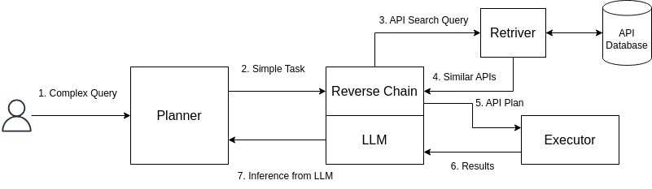

# ReverseGPT

Turn a natural-language request into a chain of API calls.

ReverseGPT layers [Reverse Chain](https://arxiv.org/abs/2310.04474) on top of a
[RestGPT](https://arxiv.org/abs/2306.06624)-style planner. The planner breaks a request
into small steps. For each step, Reverse Chain picks the API that finishes it, then works
backwards to find the APIs that produce any argument it is still missing.



## How it works

1. **Plan.** The planner writes the next step in plain language, given the request and
   what earlier steps returned.
2. **Select.** A FAISS index over the tool docs shortlists candidate APIs, and the model
   picks the one that carries out the step.
3. **Fill arguments.** The model fills what it can from the request and from earlier
   results, which it refers to as `$$PREV[i]`.
4. **Reverse chain.** For each required argument that is still missing, the model picks an
   API that produces it and the process repeats on that API, up to `max_chain_depth`.
5. **Execute.** Calls run against a handler for each API. By default that is an offline
   mock of the DevRev API, so the whole loop runs without a backend.

## Install

Python 3.10 or newer.

```bash
git clone https://github.com/Lazypilottt/ReverseGPT.git
cd ReverseGPT
python -m venv .venv && source .venv/bin/activate
pip install -e .
```

Embeddings run locally with `sentence-transformers`, which installs PyTorch. On Linux
without a GPU, install the CPU build first to avoid a multi-gigabyte CUDA download:

```bash
pip install torch --index-url https://download.pytorch.org/whl/cpu
```

## Configure

```bash
cp config.example.ini config.ini
export OPENAI_API_KEY=sk-...
```

Every key in `config.ini` is optional. The most useful ones:

| Section       | Key               | Default                                  |
| ------------- | ----------------- | ---------------------------------------- |
| `[llm]`       | `model`           | `gpt-4o-mini`                            |
| `[llm]`       | `base_url`        | OpenAI. Any OpenAI-compatible server works, e.g. `http://localhost:11434/v1` for Ollama |
| `[retriever]` | `embedding_model` | `sentence-transformers/all-MiniLM-L6-v2` |
| `[retriever]` | `top_k`           | `5` candidate APIs per decision          |
| `[agent]`     | `max_plan_steps`  | `8`                                      |
| `[agent]`     | `max_chain_depth` | `3`                                      |

The API key can also go in `[llm] api_key`, and `OPENAI_BASE_URL` works like `base_url`.

## Use

```bash
reversegpt tools                    # list the tools found in data/api_documentation
reversegpt index                    # build the FAISS index (optional, see below)
reversegpt run "Prioritize my P0 issues and add them to the current sprint"
```

`run` builds the index on first use and rebuilds it whenever the tool docs change, so
`index` is only needed to do that ahead of time. Other options:

- `reversegpt run -` reads the request from stdin.
- `-o path.json` writes the tool calls somewhere other than `output/output.json`.
- `-v` also prints prompts and raw model replies. The full log always goes to `logs/run.log`.
- `-c other.ini` uses a different config file.

The output is a list of tool calls. Later calls refer to earlier results by position:

```json
[
  { "tool_name": "who_am_i", "arguments": [] },
  {
    "tool_name": "work_list",
    "arguments": [
      { "argument_name": "owned_by", "argument_value": ["$$PREV[0]"] },
      { "argument_name": "issue.priority", "argument_value": ["p0"] }
    ]
  },
  {
    "tool_name": "prioritize_objects",
    "arguments": [{ "argument_name": "objects", "argument_value": "$$PREV[1]" }]
  }
]
```

### From Python

```python
from reversegpt import ReverseGPT, load_settings

agent = ReverseGPT.from_settings(load_settings("config.ini"))
result = agent.run("Summarize high severity tickets from customer Acme")
print(result.tool_calls())
print(result.status)  # "done", "unrelated" or "max_steps"
```

## Adding tools

Each tool is one JSON file in `data/api_documentation`:

```json
{
  "name": "get_similar_work_items",
  "description": "Returns a list of work items that are similar to the given work item.",
  "arguments": [
    { "name": "work_id", "type": "string", "required": true,
      "description": "The ID of the work item to find similar items for." }
  ],
  "returns": [
    { "name": "similar_work_items", "type": "array of strings",
      "description": "IDs of work items similar to the given one." }
  ],
  "examples": ["Find issues similar to don:core:dvrv-us-1:devo/0:issue/1"]
}
```

`examples` are optional but help retrieval. Argument names may contain dots
(`ticket.severity`).

A new tool works as soon as its file is added: tools without a handler return placeholder
outputs, which is enough for planning. To call a real backend, give the agent your own
handlers. Each one receives the arguments as keyword arguments, with dots replaced by
underscores, and returns a dict keyed by the `returns` names, plus an optional `message`:

```python
from reversegpt.executor import Executor

def work_list(limit=50, **filters):
    ids = my_client.list_work(limit=limit, **filters)
    return {"work_ids": ids, "message": f"Found {len(ids)} work items."}

agent.executor = Executor(handlers={"work_list": work_list, ...})
```

## Development

```bash
pip install -e ".[dev]"
pytest
ruff check . && ruff format --check .
```

The tests use a scripted model and fake embeddings, so they run offline. The tests in
`tests/test_retriever.py` that check real embedding quality download a model and are
skipped in CI.

## License

MIT. See [LICENSE](LICENSE).
